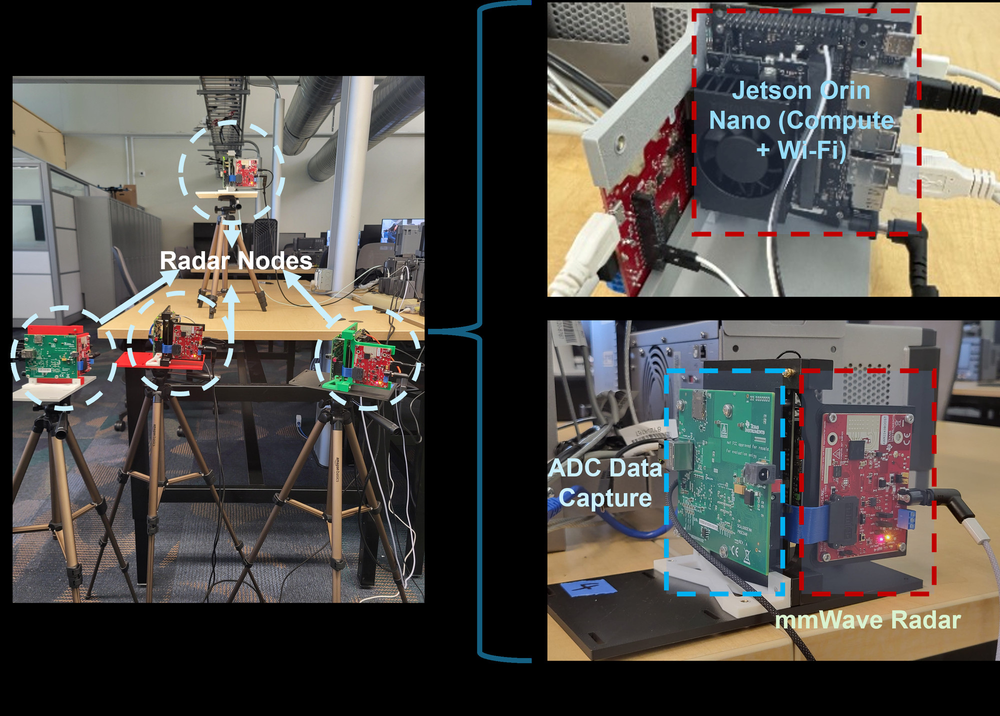

# NetRadar-Node

Radar node software for **NetRadar**, a networked mmWave radar testbed. Each node
runs a real-time radar pipeline on an NVIDIA Jetson (range-Doppler processing,
CFAR detection, angle estimation, DBSCAN clustering, JPDA tracking) and streams
its detections to a **fusion center** over MQTT. Nodes fire their radars on a
shared, clock-synchronized hardware trigger so their frames line up in time.

- **Fusion center:** [NetRadar-FusionCenter](https://github.com/NetRadar-Testbed/NetRadar-FusionCenter)
- **Full documentation:** <https://netradar-testbed.github.io>

> NetRadar is built to be set up **from scratch on your own network**. Nothing in
> this repository points at any existing deployment; you create your own
> Tailscale network, fusion center and credentials.

## Hardware (per node)

<p align="center">
  <br>
  <em>A four-node NetRadar testbed. Each node: NVIDIA Jetson Orin Nano (compute + Wi-Fi), TI DCA1000EVM (ADC data capture), TI AWR2243BOOST (mmWave radar).</em>
</p>

- NVIDIA Jetson Orin Nano, JetPack 6.x
- TI AWR2243BOOST radar board
- TI DCA1000EVM capture card
- USB cable AWR2243BOOST → Jetson (FTDI), Ethernet cable DCA1000 → Jetson
  (a dedicated port, default `enP8p1s0`)
- Trigger wiring: **Jetson 40-pin header pin 8 → AWR2243BOOST J5 pin 9
  (SYNC_IN)**, plus a **ground wire** between the Jetson (e.g. header pin 6) and
  the radar board. The radar captures one frame per rising edge (hardware
  trigger, `triggerSelect=2` in `setup_radar/mmwaveconfig.txt`)

## Quick start

Set up the fusion center first (it generates this node's credentials). Then,
on each Jetson:

```bash
# 1. Join your own Tailscale network (opens a login link)
curl -fsSL https://tailscale.com/install.sh | sh
sudo tailscale up

# 2. Get the code and install everything (≈20–40 min)
git clone https://github.com/NetRadar-Testbed/NetRadar-Node.git
cd NetRadar-Node
sudo ./install.sh                # add --dca-iface <name> if the DCA1000 port isn't enP8p1s0

# 3. Configure this node: paste the block the fusion center's setup.sh printed for it
./configure.sh

# 4. Sync the clock to the fusion center, then reboot once
sudo ./time-sync/chrony-setup.sh slave <fusion-center-host>
sudo reboot
```

After the reboot the `netradar-node` service starts automatically, connects to
the fusion center and waits for commands from its dashboard.

```bash
systemctl status netradar-node
journalctl -u netradar-node -f
```

Step-by-step instructions, wiring and troubleshooting:
<https://netradar-testbed.github.io/node/>

## Node web pages

| Port | Page |
| :--- | :--- |
| 5001 | Live visualizer: range-Doppler map, CFAR detections, centroids, tracks |
| 5003 | Live service logs |

They listen on the node's Tailscale address (set by `configure.sh`), so they are
reachable only from devices on your own tailnet: `http://<node-host>:5001`.

## Testing a node on its own

`test/run_tests.sh` runs the pipeline without a fusion center (live radar with
the local trigger, raw-data capture, playback of a capture, `.mat` export):

```bash
sudo ./test/run_tests.sh
```

## PyTorch

`install.sh` installs the **CPU** build of PyTorch from PyPI (the default on
aarch64). The pipeline runs DBSCAN on the CPU, and the CPU build is roughly twice
as fast for this workload as NVIDIA's CUDA wheel (`torch.cdist`, n = 2000:
~12 ms vs ~24 ms on an Orin Nano).

## Repository layout

| Path | Contents |
| :--- | :--- |
| `src/` | Pipeline (`main.py`), node service (`node_launcher.py`), visualizer (`ui/`), trigger client and worker (`hardware_trigger_mqtt/`), local trigger (`hardware_trigger/`) |
| `src/radar/` | Data acquisition, configuration and processing stages (`processing/`) |
| `setup_radar/` | AWR2243 configuration program (TI mmWaveLink) and `mmwaveconfig.txt` |
| `DCA1000/` | DCA1000EVM CLI source (TI) and `DCAconfig.json` |
| `scripts/` | Radar start/reset/recovery scripts, systemd unit template |
| `time-sync/` | Chrony setup and clock-offset measurement tools |
| `test/` | Test runner and integration/capture/playback tests |
| `third_party/` | Unmodified FTDI D2XX driver |
| `docs/ARCHITECTURE.md` | Detailed description of the node's processing pipeline |

## Security notes

- `.env` holds this node's MQTT password. It is created by `configure.sh`,
  readable only by you and root, and ignored by git. Never commit it.
- The node service runs as root (GPIO and radar setup need it) with systemd
  sandboxing.
- Keep the node and fusion center on a Tailscale network that only you control.

## Citing NetRadar

If you use this software, or a testbed built with it, in published work, please
cite the papers below **and** state that your testbed was built using the
NetRadar open-source software (with the version). See `NOTICE` and
<https://netradar-testbed.github.io/citing/>.

```bibtex
@INPROCEEDINGS{11205142,
  author={Banik, Anirban and Giridhar, Lalitha and Kattekola, Aaditya Prakash and Pallaprolu, Anurag and Mostofi, Yasamin and Sabharwal, Ashutosh and Madhow, Upamanyu},
  booktitle={2025 IEEE Radar Conference (RadarConf25)},
  title={mmSnap: Bayesian One-Shot Fusion in a Self-Calibrated mmWave Radar Network},
  year={2025},
  pages={1116-1121},
  doi={10.1109/RadarConf2559087.2025.11205142}}

@INPROCEEDINGS{10942741,
  author={Banik, Anirban and Mostofi, Yasamin and Sabharwal, Ashutosh and Madhow, Upamanyu},
  booktitle={2024 58th Asilomar Conference on Signals, Systems, and Computers},
  title={Optimal Self-Calibration for Collaborative Sensing in mmWave Radar Networks},
  year={2024},
  pages={218-222},
  doi={10.1109/IEEECONF60004.2024.10942741}}
```

## Credits

Developed as part of the **Chirp Capstone Project 2025–2026, University of
California, Santa Barbara.**

- **Authors:** William Ni, Oviya Seeniraj, Andrey Otvagin, Vihan Jayaraman,
  Jason Wang, Anirban Banik
- **Mentor:** Anirban Banik
- **Advising professors:** Upamanyu Madhow, Yogananda Isukapalli

## License

Apache License 2.0 — see `LICENSE` and `NOTICE`. Bundled Texas Instruments and
FTDI components keep their own licences; see `THIRD_PARTY_NOTICES.md`.
